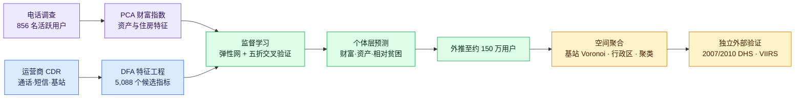

<div align="center">

# Predicting Poverty and Wealth from Mobile Phone Metadata

### 一份面向教学、审计与开放复现的中文研究型 Notebook

<p>
  <a href="https://doi.org/10.1126/science.aac4420"></a>
  <a href="https://doi.org/10.3886/E100144V5"></a>
  <a href="https://creativecommons.org/licenses/by/4.0/"></a>
</p>

<p>
  <strong>856 名电话调查受访者 · 5,088 个候选行为特征 · 约 150 万手机用户 · 30 个行政区</strong>
</p>

<p>
  从手机通信元数据到个体财富预测，再到全国空间分布与 DHS 外部验证。<br>
  本项目在公开归档允许的范围内，重建论文的分析逻辑、图表证据与复刻边界。
</p>

<p>
  <a href="./Predicting%20poverty%20and%20wealth%E9%A1%B9%E7%9B%AE%E5%A4%8D%E5%88%BB.ipynb"><strong>打开 Notebook</strong></a>
  ·
  <a href="./Predicting%20poverty%20and%20wealth%E9%A1%B9%E7%9B%AE%E5%A4%8D%E5%88%BB.html"><strong>查看静态 HTML</strong></a>
  ·
  <a href="https://doi.org/10.1126/science.aac4420"><strong>原论文</strong></a>
  ·
  <a href="https://doi.org/10.3886/E100144V5"><strong>官方复刻归档</strong></a>
</p>

</div>

---

## 项目简介

在许多低收入国家，人口普查和住户调查成本高、更新慢，精细到小区域的社会经济统计尤其稀缺。Blumenstock、Cadamuro 与 On（2015）提出了一条极具影响力的测量路径：

> 用少量电话调查获得真实的社会经济标签，从大规模手机通信元数据中学习行为与财富之间的预测关系，再把个体预测汇总为空间统计，并使用独立政府调查进行外部验证。

本仓库不是原论文的官方实现，也不声称恢复了受保密协议约束的原始运营商数据。它是一份**中文、教学型、可审计的独立复刻**：既展示公开中间结果能够支持哪些图表，也明确标出哪些结论无法在缺少原始 CDR、全国用户位置、完整 DHS 和塔址的条件下从头再现。

### 这个仓库适合谁？

- 希望理解计算社会科学、数字足迹与贫困测量的读者；
- 第一次接触 PCA、弹性网、交叉验证、ROC/AUC 或空间聚合的学生；
- 需要判断“重画论文图”与“从原始数据重训模型”差别的复刻研究者；
- 关注数据授权、隐私边界和科研诚信的开放科学实践者。

---

## 研究设计，一图读懂



<details>
<summary><strong>为什么这不是一项因果研究？</strong></summary>

模型学习的是手机行为与财富之间的预测关系。短信规律性、移动范围或社交网络位置可能反映教育、职业、城市居住、资费承受能力等共同因素；论文并未识别“改变手机行为会导致财富变化”的因果效应。该框架适合测量与预测，不应被解释为行为干预机制。

</details>

---

## 复刻范围

本项目采用四级证据标签，避免把不同强度的结果混为一谈：

| 标签 | 含义 |
|---|---|
| **严格复算** | 使用归档中的同一数值输入重新计算指标 |
| **中间结果重绘** | 使用原研究保存的预测、ROC 或汇总输出重新作图 |
| **方法教学示意** | 依据论文方法解释流程，不冒充原始实证结果 |
| **无法复刻** | 关键输入缺失或仅有样例，明确停止而不模拟填补 |

### 正文与补充材料矩阵

| 原文项目 | 本项目状态 | 说明 |
|---|:---:|---|
| Figure 1A | ✅ 中间结果重绘 | 从保存的实际财富与 out-of-fold 预测重算相关并绘制 LOESS |
| Figure 1B–C | ✅ 中间结果重绘 | 使用保存的 ROC 坐标重画曲线并积分 AUC |
| Figure 2 | ⛔ 无法复刻 | 缺少约 150 万用户的完整预测、位置、原始 CDR 与真实塔址 |
| Figure 3 | ✅ 中间结果重绘 | 使用区级/聚类级汇总结果重算加权相关、回归与地图 |
| Figure S1 | 🧭 方法教学示意 | 解释 DFA 特征工程流程，不是原状态机图的数值复刻 |
| Figure S2 | ✅ 中间结果重绘 | 使用 19 行样本量实验输出重画性能曲线 |
| Figure S3 | 🟡 部分重绘 | 归档保存 1,696 行单特征结果，少于论文所述 5,088 个候选特征 |
| Figure S4 | ⛔ 无法复刻 | 完整训练特征矩阵缺失，不能恢复正则化路径 |
| Figure S5 | ⛔ 无法复刻 | 真实基站和 DHS 聚类坐标被删减或遮蔽 |
| Figure S6 | ✅ 中间结果重绘 | 使用保存聚类输出比较 Kigali 城市与其他农村区域 |
| Figure S7 | ⛔ 无法复刻 | 缺少论文使用的精确 VIIRS 版本与空间化用电预测 |
| Figure S8 | ✅ 中间结果重绘 | 比较 2007 DHS、2009 CDR 插补与 2010 DHS |
| Table S1 | 🟡 部分复算 | 可复算最优财富预测的相关和保存 ROC 的 AUC |
| Table 1 | — 不复刻 | 描述性样本表，不属于模型结果 |

---

## 关键结果速览

| 证据层级 | 论文报告结果 | 应如何理解 |
|---|---:|---|
| 个体财富预测 | `r ≈ 0.68`, `R² ≈ 0.46` | 手机行为能够恢复部分个体财富排序，但预测并不完美 |
| 区级财富外部验证 | `r ≈ 0.916–0.917` | CDR 汇总与独立 2010 DHS 的地区空间排序高度一致 |
| 区级用电率 | `r ≈ 0.93` | 同一框架可以预测财富指数之外的家庭属性 |
| DHS 聚类财富 | `r ≈ 0.79` | 更细空间尺度仍相关，但受坐标扰动和抽样误差影响更大 |
| 城市 / 农村聚类 | `r ≈ 0.64 / 0.50` | 全国结果不完全由城乡均值差异驱动 |
| 两轮 DHS 之间的插补 | `2009 CDR ↔ 2010 DHS: r ≈ 0.91` | 手机估计可能成为低频官方调查之间的临时统计 |

> [!NOTE]
> 当前哈希预测文件包含 857 条可用记录，直接复算 Figure 1A 得到的相关约为 `0.714`，高于论文报告的约 `0.68`。Notebook 保留这一版本差异，不通过删行或调参“凑”论文数字。

---

## 仓库结构

```text
.
├── README.md
├── Predicting poverty and wealth项目复刻.ipynb   # 主体：中文教学型复刻
└── Predicting poverty and wealth项目复刻.html    # 含已有输出的静态版本
```

本仓库采取最保守的发布方式：**只托管本项目生成的 README、Notebook 和 HTML**。原作者归档、世界银行区界、论文正文和补充材料都不在仓库中；运行时所需数据必须由复现者从下方列出的官方来源自行获取。

---

## 快速开始

### 只阅读，不运行

直接打开仓库中的 [静态 HTML](./Predicting%20poverty%20and%20wealth%E9%A1%B9%E7%9B%AE%E5%A4%8D%E5%88%BB.html)。它保留 Notebook 已有输出，适合快速浏览研究思路、图表和限制。

> [!TIP]
> GitHub 仓库页面通常不会直接执行 HTML。下载后用浏览器打开，或启用 GitHub Pages，将该 HTML 作为静态页面发布。

### 交互运行 Notebook

建议使用 Python 3.10+。Notebook 的现代重绘部分需要以下依赖：

```bash
python -m pip install jupyter numpy pandas matplotlib pyshp
```

在项目根目录启动：

```bash
jupyter lab
```

在运行 Notebook 之前，必须先完成下一节的两个数据下载步骤。准备完成后打开 `Predicting poverty and wealth项目复刻.ipynb`，然后选择 **Run All**。

---

## 获取完全相同的复现数据

> [!IMPORTANT]
> 本仓库没有镜像任何第三方数据。请只从下列官方页面下载，并按照指定目录名解压。不要用 Kaggle、网盘、他人 GitHub 仓库或同名现代数据替代，否则无法保证与本项目使用的输入一致。

### 链接与知识产权说明

下列链接只指向权利方或数据托管机构控制的官方页面与官方文件主机，不复制、缓存或重新分发第三方数据，也不绕过登录、许可确认或其他访问控制。ICPSR 数据应由每位复现者自行登录并接受该站点当时有效的 [Terms of Use](https://www.icpsr.umich.edu/sites/icpsr/posts/shared/what-is-researcher-passport)；世界银行区界直链是其官方数据目录公开列出的下载资源，使用者仍应遵守 [World Bank Dataset Terms](https://www.worldbank.org/ext/en/legal/terms-conditions/datasets)，并以数据目录页面作为授权状态与版本信息的权威入口。

本 README 公布的文件名、目录结构、字节数、行数和 SHA-256 仅用于识别与校验下载内容，不包含数据记录本身。若官方链接、许可或使用条款以后发生变化，应以对应官方数据页面当时显示的内容为准。提供链接和校验信息不表示原作者、ICPSR、世界银行或 AAAS 对本项目提供认可或背书。

### 第一步：下载原作者 ICPSR 复刻归档

本项目使用的是 **ICPSR Study 100144，Version 5.1**。当前版本是 2026-07-31 的元数据迁移更新，版本 DOI 仍为 `10.3886/E100144V5`。

1. 打开永久入口：<https://doi.org/10.3886/E100144V5>。
2. 确认页面标题为 *Predicting Poverty and Wealth from Mobile Phone Metadata*，研究编号为 `ICPSR 100144`。
3. 确认页面显示 `Self-published`、`Public`、`Creative Commons Attribution 4.0 International`，版本历史中的最新版本为 `V5.1`。
4. 选择 **Download / Download All Files**。ICPSR 如要求登录，请创建或登录 Researcher Passport，并接受 Terms of Use 与 CC BY 4.0 条款。
5. 解压下载包，将实际数据根目录放到仓库根目录并命名为：

```text
ICPSR_100144-V5.1/
├── README.txt
├── analysis/
├── modeling/
└── validation/
```

不要多保留一层下载包包装目录。最终必须能从仓库根目录直接找到：

```text
ICPSR_100144-V5.1/README.txt
ICPSR_100144-V5.1/modeling/data/train/PhoneSurveyFeatsHash.csv
ICPSR_100144-V5.1/validation/data/out/districts2010.csv
```

> [!WARNING]
> 不要下载已经停止分发的 V3，也不要把论文页面中的“原始 CDR 可向作者申请”理解为本 Notebook 的必要步骤。本项目使用的正是 V5.1 公开归档中经过哈希、删减或汇总的文件；受保密协议约束的完整运营商 CDR 从来不在这个公开下载包里。

### 第二步：下载 2012 年卢旺达区级边界

地图轮廓来自世界银行 *Rwanda Admin Boundaries and Villages* 数据集中的 **Rwanda Districts**：

- 数据目录：<https://datacatalog.worldbank.org/search/dataset/0041453/rwanda-admin-boundaries-and-villages>
- 本项目使用的区界压缩包：[rwa_district.zip](https://datacatalogfiles.worldbank.org/ddh-published/0041453/1/DR0051757/rwa_district.zip)
- 授权： [Creative Commons Attribution 4.0 International](https://creativecommons.org/licenses/by/4.0/)

下载并解压后，把整套 Shapefile 文件放到：

```text
external_data/
└── rwa_district/
    ├── District.CPG
    ├── District.dbf
    ├── District.prj
    ├── District.sbn
    ├── District.sbx
    ├── District.shp
    ├── District.shp.xml
    └── District.shx
```

`.shp` 只保存几何主体，`.dbf`、`.shx` 和 `.prj` 分别承载属性、空间索引和坐标系信息，因此不能只复制一个 `District.shp`。

### 第三步：验证下载内容与本项目输入一致

在仓库根目录运行下面的 Python 代码。它按“相对路径 + 每个文件的 SHA-256”生成稳定的目录指纹；如果文件数量、总字节数和指纹全部相同，就说明你得到的是本项目使用的同一套文件。

```python
from pathlib import Path
import hashlib


def tree_fingerprint(root):
    root = Path(root)
    files = sorted(
        (path for path in root.rglob("*") if path.is_file()),
        key=lambda path: path.relative_to(root).as_posix(),
    )

    digest = hashlib.sha256()
    for path in files:
        relative_path = path.relative_to(root).as_posix()
        file_hash = hashlib.sha256(path.read_bytes()).hexdigest()
        digest.update(
            relative_path.encode("utf-8")
            + b"\0"
            + file_hash.encode("ascii")
            + b"\n"
        )

    return len(files), sum(path.stat().st_size for path in files), digest.hexdigest()


expected = {
    "ICPSR_100144-V5.1": (
        61,
        9_229_483,
        "5aed6e2141e2741a58bc3fe46858b0400d4d11cff39ed38bf2320367148723d7",
    ),
    "external_data/rwa_district": (
        8,
        2_931_665,
        "37fd1dc68d679d9edc8eda508a1e17b40372c6a610e3acaa38f97fa60a4174ac",
    ),
}

for folder, expected_result in expected.items():
    actual_result = tree_fingerprint(folder)
    print(folder)
    print("  expected:", expected_result)
    print("  actual:  ", actual_result)
    print("  match:   ", actual_result == expected_result)
```

预期两项都输出 `match: True`。若官方以后只增加包装层或元数据，整目录指纹可能变化；此时应继续核对下列核心文件，不要直接忽略差异：

<details>
<summary><strong>核心文件 SHA-256 与行数</strong></summary>

| 文件 | SHA-256 | 数据行数 |
|---|---|---:|
| `ICPSR_100144-V5.1/README.txt` | `4d705ea2bbf1f714c344397b798b7b62ee31261928092e2fa106e05a34b5019f` | — |
| `modeling/data/train/PhoneSurveyFeatsHash.csv` | `ab13e0a866a9a5b005c513135062b2399fb40c47570ded7bcafe4eeb94eb90c5` | 857 |
| `modeling/data/train/feature_r2.csv` | `03f966e098d350ad4d32a3dbfff51eb769cde45672bfc7e6b983b48d1239f634` | 1,696 |
| `validation/data/out/districts2010.csv` | `465c7c2f9316a10066f3c784e1e90e77c400968d4471e5326a30b4695676b77f` | 30 |
| `validation/data/out/clusters2010.csv` | `5413f864232ae16d34cba6228928f2198159a32be53896f68c3342ccd3758ec5` | 487 |
| `external_data/rwa_district/District.shp` | `bd0dcc28b3c38d1f35bf644e1d2e41febce2fd1780e8bb60e80ff98c2bce6f5a` | 30 个区 |

CSV 的“数据行数”不包括表头。所有哈希均针对文件原始字节计算。

</details>

### 运行前检查

- 当前工作目录必须是仓库根目录；
- `ICPSR_100144-V5.1/` 与 `external_data/rwa_district/` 必须存在；
- 上述目录指纹应与本项目记录一致；
- Notebook 不联网下载数据，也不会改写 ICPSR 原始归档；
- 原作者的历史 Python/R/Spark 管线依赖旧版 `scikit-learn 0.16.1`、GraphLab、JVM、Spark 与 SBT；本 Notebook 主要从公开中间结果开始重绘，不要求完整恢复该旧环境。

---

## 数据可用性与来源

### 1. 原作者复刻归档（不随本仓库分发）

Blumenstock, Cadamuro & On, *Predicting Poverty and Wealth from Mobile Phone Metadata*, ICPSR 100144, Version 5.1：

- 官方页面：<https://doi.org/10.3886/E100144V5>
- 授权： [Creative Commons Attribution 4.0 International](https://creativecommons.org/licenses/by/4.0/)
- 本项目用途：公开代码、哈希调查特征、保存预测、ROC 点与地区/聚类汇总结果
- 修改说明：本项目新增中文解释、Python 重绘和可复刻性审计；未声称获得被删减的原始运营商数据

ICPSR README 明确指出：原始 CDR、全国完整预测、真实塔址、用户位置与完整 DHS 输入已被删减、遮蔽或仅保留表头。因此，本项目不会用其他年份、其他国家或模拟数据冒充原研究数据。

### 2. 卢旺达行政区边界（不随本仓库分发）

World Bank, *Rwanda Admin Boundaries and Villages*：

- 数据页面：<https://datacatalog.worldbank.org/search/dataset/0041453/rwanda-admin-boundaries-and-villages>
- 授权： [CC BY 4.0](https://creativecommons.org/licenses/by/4.0/)
- 署名：The World Bank: *Rwanda Admin Boundaries and Villages*. Data source: World Bank Data Catalog.
- 版本：2012 年 Rwanda Districts，下载于 2026-10-30
- 用途：只提供地图几何轮廓；不包含贫困、财富或用电变量

本仓库不再分发这些文件；复现者应按上方步骤从世界银行下载完整压缩包。

---

## 版权与授权边界

本仓库包含不同来源、不同权利状态的材料，**不存在一个许可证自动覆盖全部内容**。

| 材料 | 是否建议上传 | 权利依据与要求 |
|---|:---:|---|
| 本项目 Notebook、HTML 与 README | ✅ 可以 | 独立复刻成果；其中使用的第三方数据仍须按来源署名 |
| `ICPSR_100144-V5.1/` | 不上传 | 虽然官方项目为 Public、CC BY 4.0，本仓库仍采用保守方案，只提供 DOI、下载步骤和文件指纹 |
| `external_data/rwa_district/` | 不上传 | 虽然世界银行采用 CC BY 4.0，本仓库只提供官方直链、目录结构和文件指纹 |
| Science 正文 PDF | ❌ 不建议 | 出版商版本标明仅供个人、非商业使用且 AAAS 保留版权；请改为链接 DOI |
| Science 补充材料 PDF | ❌ 不建议 | 未发现允许在第三方 GitHub 仓库重新分发的开放许可证；请链接官方页面 |

> [!IMPORTANT]
> CC BY 4.0 允许复制、再分发和改编，但必须提供适当署名、许可证链接，并说明是否做过修改。它不代表原作者、ICPSR、世界银行或 AAAS 对本复刻提供背书。

本仓库当前没有替仓库维护者的原创 Notebook/README 指定一个统一的仓库级许可证。正式公开前，可根据你的开放范围另行添加 `LICENSE`；无论选择何种许可证，都不能覆盖或取消上述第三方材料的原有 CC BY 4.0 条款。

---

## 已知限制

1. 本项目无法重新生成原始 5,088 个 DFA 特征，也无法从头拟合论文的最优 101 特征弹性网。
2. Figure 3、S6、S8 从原作者保存的空间汇总结果开始，不是重新执行用户定位和 Voronoi 叠加。
3. 2010 聚类输出为 487 行，而论文描述 492 个 DHS 聚类；现有归档不足以恢复缺少记录。
4. Figure S3 的公开文件包含 1,696 个单特征结果，少于论文描述的 5,088 个候选特征。
5. Python LOESS 置信带是对原 R 结果的可移植近似，不追求逐像素一致。
6. 手机用户不等于全体人口；模型在其他国家、运营商或时期使用前必须重新调查、验证与校准。

---

## 科研伦理

通信元数据即使不含通话内容，也可能暴露位置、社交关系和生活规律。把预测直接用于福利资格、信贷或个体定向会带来误分类、排除与监控风险，尤其可能遗漏没有手机或不活跃的最贫困人群。

实际应用至少应包含：

- 数据最小化、访问控制与隐私保护；
- 代表性、误差和群体公平性审计；
- 独立真值验证与模型漂移监测；
- 人工复核、申诉机制和明确的责任边界；
- 对参与者、运营商和公共机构的透明治理。

---

## 引用

如果你的工作使用了原论文的方法或结论，请优先引用原论文：

```bibtex
@article{blumenstock2015predicting,
  title   = {Predicting poverty and wealth from mobile phone metadata},
  author  = {Blumenstock, Joshua and Cadamuro, Gabriel and On, Robert},
  journal = {Science},
  volume  = {350},
  number  = {6264},
  pages   = {1073--1076},
  year    = {2015},
  doi     = {10.1126/science.aac4420}
}
```

使用归档文件时，同时引用 ICPSR 数据集：

```text
Blumenstock, Joshua, Gabriel Cadamuro, and Robert On.
Predicting Poverty and Wealth from Mobile Phone Metadata.
ICPSR 100144, Version 5.1（major-version DOI: V5）.
https://doi.org/10.3886/E100144V5
```

---

## 发布前检查清单

- [ ] 从 Git 提交范围中排除两篇 Science PDF；
- [ ] 保留 ICPSR 与世界银行的作者、标题、DOI/来源和 CC BY 4.0 说明；
- [ ] 检查 Notebook 与 HTML 中没有账号、密钥或个人信息；
- [ ] 确认所有 Shapefile 配套文件一起提交；
- [ ] 根据需要为原创 Notebook/README 选择单独的仓库级许可证；
- [ ] 在一个全新克隆目录中测试 Notebook 的路径与关键单元；
- [ ] 如使用 GitHub Pages，确认静态 HTML 可以正常加载图表与中文字体。

---

<div align="center">

**Independent educational replication · Not affiliated with or endorsed by the original authors, AAAS, ICPSR, or the World Bank**

<sub>开放复现不仅是把文件放上网，更是让每一个数字的来源、每一个缺口的原因、每一个授权的边界都可被检查。</sub>

</div>
